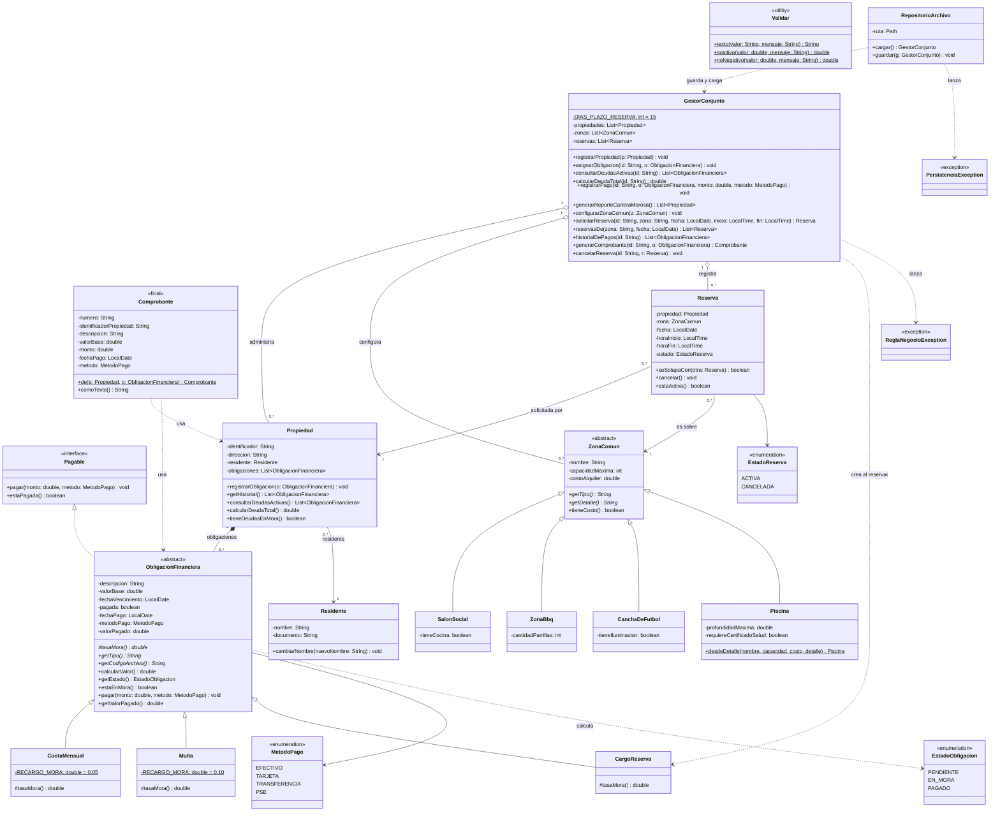
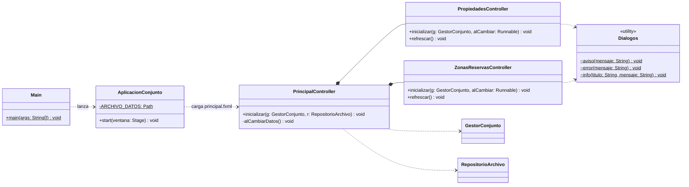

# Sistema de administración de un conjunto residencial

Proyecto Integrador del curso de **Programación Orientada a Objetos (POO)**.

El sistema lleva el cobro de la administración de un conjunto residencial de casas (cuotas, multas y cargos por reserva), el reporte de cartera morosa y la reserva de las zonas comunes (salón social, zona BBQ, cancha y piscina). Está hecho en Java 21 con interfaz gráfica en JavaFX y guarda la información en un archivo de texto plano.

---

## Tabla de contenido

1. [Equipo](#equipo)
2. [Entrega 1: definición del problema y requerimientos](#entrega-1-definición-del-problema-y-requerimientos)
3. [Entrega 2: diseño orientado a objetos](#entrega-2-diseño-orientado-a-objetos)
4. [Diagrama de clases final](#diagrama-de-clases-final)
5. [Cambios respecto a la Entrega 2](#cambios-respecto-a-la-entrega-2)
6. [Conceptos POO aplicados](#conceptos-poo-aplicados)
7. [Arquitectura del sistema](#arquitectura-del-sistema)
8. [Estructura del proyecto](#estructura-del-proyecto)
9. [Jerarquía de clases](#jerarquía-de-clases)
10. [Formato del archivo de datos](#formato-del-archivo-de-datos)
11. [Reglas de negocio](#reglas-de-negocio)
12. [Trazabilidad: requerimientos, clases y temas](#trazabilidad-requerimientos-clases-y-temas)
13. [Cómo ejecutar el proyecto](#cómo-ejecutar-el-proyecto)
14. [Registro de decisiones](#registro-de-decisiones)
15. [Limitaciones conocidas](#limitaciones-conocidas)
16. [Bitácora de uso de IA](#bitácora-de-uso-de-ia)

---

## Equipo

Los roles son los iniciales; según las instrucciones del curso, rotan en cada corte del proyecto.

| Integrante | Rol inicial |
|---|---|
| Mauricio Vargas | Responsable de producto |
| Santiago Wagner | Responsable de calidad |
| Danna Garay | Responsable de integración |
| Tomás Bermúdez | Responsable de integración |
| Mariana Albarracín | Responsable de diseño |
| Santiago Rengifo | Responsable de diseño |

**Repositorio:** https://github.com/DannaV18/ProyectoPoo

---

## Entrega 1: definición del problema y requerimientos

### Contexto

El proyecto lo vamos a desarrollar pensando en un conjunto residencial de casas con zonas comunes como salón social, zona de BBQ y canchas. Este tipo de copropiedades necesita llevar un control constante del cobro de la administración, de quién debe y de cómo se reparten esas zonas comunes entre los residentes.

### Actores

- **Administrador:** es quien maneja el sistema. Registra las cuotas, multas y demás cobros, revisa qué se ha pagado, hace seguimiento a los residentes morosos y define qué zonas comunes existen y cómo se pueden usar.
- **Residente:** es quien usa el sistema para consultar cuánto debe, ver su historial de pagos y pedir o cancelar una reserva de zona común.

### Proceso actual

Hoy en día todo esto se hace de forma manual y sin nada que lo conecte. Las cuentas y la cartera se llevan en hojas de cálculo que no siempre se actualizan a tiempo. Las reservas se piden por mensajes de texto o se anotan en una agenda física en la portería, y los comprobantes de pago se mandan por WhatsApp o correo.

### Dolor

Esto hace que se pierdan comprobantes de pago, lo que genera cobros mal hechos y reclamos de residentes que sí están al día. También pasa que se cruzan las reservas porque no hay un solo lugar donde consultarlas, y el administrador se demora bastante cada mes cuadrando manualmente toda la información.

### Impacto

- **Económico:** se recauda mejor y se reduce la cartera morosa al calcular las obligaciones y multas de forma automática.
- **Social:** hay menos conflictos por cobros mal hechos o reservas cruzadas, lo que mejora la convivencia entre residentes.
- **Técnico:** se deja de depender de hojas sueltas y agendas físicas, y se pasa a un sistema que guarda la información de forma ordenada y confiable.

### Requerimientos

RF-01 a RF-10 y los dos RNF son los de la Entrega 1. RF-11 a RF-13 se agregaron en la implementación para cubrir lo que el actor Residente ya tenía descrito (ver su historial de pagos, cancelar una reserva y tener el soporte de su pago).

| ID | Descripción | Actor | Prioridad | Criterio de aceptación |
|---|---|---|---|---|
| RF-01 | Registrar una nueva propiedad del conjunto y asociarla con los datos del residente responsable | Administrador | Alta | No se pueden registrar dos propiedades con el mismo identificador (por ejemplo, "Casa 4") |
| RF-02 | Asignar distintos tipos de obligación financiera (cuota mensual, multa, reserva) a una propiedad | Administrador | Alta | La obligación queda registrada en el historial de la propiedad correspondiente |
| RF-03 | Consultar las deudas activas de su propiedad | Residente | Alta | Solo se muestran las obligaciones en estado "pendiente" o "en mora" |
| RF-04 | Calcular el valor total que debe una propiedad, aplicando la regla de cálculo propia de cada tipo de obligación | Sistema | Alta | Cada tipo de obligación aplica su propio cálculo (por ejemplo, recargo por mora) sin necesidad de preguntar de qué tipo es |
| RF-05 | Registrar el pago de una deuda específica | Administrador | Alta | El saldo de esa deuda queda en cero y su estado cambia a "pagado" de inmediato |
| RF-06 | Generar un reporte de cartera morosa | Administrador | Media | El reporte solo incluye propiedades con deudas cuya fecha de vencimiento ya pasó |
| RF-07 | Configurar las zonas comunes del conjunto (por ejemplo, cancha o salón social) | Administrador | Media | Toda zona nueva queda registrada con nombre, capacidad máxima y si tiene o no costo de alquiler |
| RF-08 | Solicitar la reserva de una zona común en un horario específico | Residente | Alta | Si la propiedad tiene deudas en mora, la solicitud se rechaza |
| RF-09 | Verificar la disponibilidad de la zona común antes de aprobar una reserva | Sistema | Alta | Se rechaza la reserva si ya existe otra aprobada para ese mismo espacio y horario |
| RF-10 | Validar los datos que se ingresan por la interfaz gráfica para evitar errores de digitación | Sistema | Baja | Si el administrador escribe texto en el campo de monto, el sistema muestra un aviso y no deja continuar |
| RF-11 | Consultar el historial de pagos de una propiedad | Residente | Media | Solo se listan las obligaciones pagadas de esa propiedad, con su fecha, valor pagado y método de pago |
| RF-12 | Cancelar una reserva propia | Residente | Media | Solo la propiedad que hizo la reserva puede cancelarla, y al cancelarla el horario queda libre |
| RF-13 | Generar el comprobante de un pago | Residente | Media | Solo existe para pagos realizados y muestra número, valor base, recargo, total pagado, fecha y método |
| RNF-01 | Guardar en archivos la información de propiedades, deudas y reservas | Sistema | Alta | Al reiniciar el programa, todos los datos vuelven a cargarse correctamente |
| RNF-02 | Manejar los errores que puedan ocurrir al leer o escribir los archivos de datos | Sistema | Alta | Si el archivo no existe, el sistema crea uno nuevo y sigue funcionando sin cerrarse |

### Plan hacia la Entrega 2

Primera trazabilidad de qué clases y temas esperábamos usar en cada requerimiento (tal como se entregó):

| Requerimiento | Clases previstas | Temas del curso |
|---|---|---|
| RF-01, RF-03, RF-05 | `Propiedad`, `Residente`, `ObligacionFinanciera` | Clases, objetos y métodos; constructores y encapsulamiento |
| RF-02, RF-04 | `ObligacionFinanciera`, `CuotaMensual`, `Multa`, `Reserva` | Herencia |
| RF-07, RF-08, RF-09 | `Propiedad`, `ZonaComun`, `Reserva` | Relaciones entre clases |
| RF-02, RF-04, RF-05 | `Pagable`, `ObligacionFinanciera`, `CuotaMensual`, `Multa`, `Reserva` | Interfaces; polimorfismo |
| RF-08, RF-09 | `Reservable`, `ZonaComun`, `Reserva`, `Horario` | Interfaces; clases anidadas |
| RF-01, RF-02, RF-09 | `Propiedad`, `CuotaMensual`, `Multa`, `Reserva` | Atributos y métodos estáticos |
| RF-06 | `AdministradorConjunto`, `Propiedad` | Relaciones entre clases; polimorfismo |

---

## Entrega 2: diseño orientado a objetos

En la Entrega 2 se presentó el primer diagrama de clases. Incluía:

- **Clases y herencia:** `Propiedad`, `Residente`, `ZonaComun`, `AdministradorConjunto` y la jerarquía de `ObligacionFinanciera`, de la que heredaban `CuotaMensual`, `Multa` y `Reserva`.
- **Atributos y métodos estáticos:** `totalPropiedades` y `getTotalPropiedades()` en `Propiedad`; `valorCuotaBase` y `actualizarCuotaBase()` en `CuotaMensual`; `VALOR_BASE_MULTA` en `Multa`; y `validarHorario()` en `Reserva`.
- **Clase anidada:** `Horario`, dentro de `Reserva`, con `horaInicio`, `horaFin` y `duracion()`.
- **Interfaces:** `Pagable`, implementada por `ObligacionFinanciera`, y `Reservable`, implementada por `ZonaComun`.
- **Polimorfismo:** `calcularValor()` abstracto en `ObligacionFinanciera` y sobrescrito en cada subclase; `calcularDeudaTotal()` en `Propiedad` lo llamaba sobre cada obligación sin preguntar de qué tipo era.

Al programarlo, el diseño cambió en varios puntos. El diagrama de la siguiente sección es el del código final, y la sección [Cambios respecto a la Entrega 2](#cambios-respecto-a-la-entrega-2) explica cada diferencia.

---

## Diagrama de clases final

Corresponde al código de la rama `main`. Se muestran los atributos y los métodos principales; se omiten los getters simples y los métodos `restaurar...` que solo usa la persistencia. Los métodos abstractos llevan `*` y los estáticos `$`.



`Validar` la usan `ObligacionFinanciera`, `Propiedad`, `Residente`, `ZonaComun` y `Piscina` en sus constructores; esas líneas se omiten para no recargar el diagrama.

**Capa de interfaz (JavaFX)**



### Grupos de clases

| Grupo | Clases | Rol en el sistema |
|---|---|---|
| Cobros | `Pagable`, `ObligacionFinanciera` (abstracta), `CuotaMensual`, `Multa`, `CargoReserva`, `Comprobante` | Todo lo que se le cobra a una propiedad, su recargo por mora, su pago y su soporte |
| Propiedades | `Propiedad`, `Residente` | Casas del conjunto y su residente responsable |
| Zonas y reservas | `ZonaComun` (abstracta), `SalonSocial`, `ZonaBbq`, `CanchaDeFutbol`, `Piscina`, `Reserva` | Espacios comunes y su uso por horario |
| Enumeraciones | `EstadoObligacion`, `EstadoReserva`, `MetodoPago` | Valores fijos que el compilador valida |
| Negocio | `GestorConjunto`, `ReglaNegocioException` | Casos de uso; único punto de entrada para la interfaz y la persistencia |
| Persistencia | `RepositorioArchivo`, `PersistenciaException` | Leer y escribir `datos_conjunto.txt` |
| Interfaz | `Main`, `AplicacionConjunto`, `PrincipalController`, `PropiedadesController`, `ZonasReservasController`, `Dialogos` | Ventanas JavaFX |
| Utilidad | `Validar` | Validaciones repetidas en varios constructores |

### Relaciones principales

| Relación | Tipo | Multiplicidad |
|---|---|---|
| `Propiedad` — `ObligacionFinanciera` | Composición: las obligaciones viven dentro del historial de la propiedad | 1 – 0..* |
| `Propiedad` — `Residente` | Asociación: un residente puede ser responsable de varias propiedades | 0..* – 1 |
| `Reserva` — `Propiedad` | Asociación | 0..* – 1 |
| `Reserva` — `ZonaComun` | Asociación | 0..* – 1 |
| `GestorConjunto` — `Propiedad`, `ZonaComun`, `Reserva` | Agregación | 1 – 0..* |
| `GestorConjunto` → `CargoReserva` | Dependencia: lo crea al aprobar una reserva con costo | — |
| `RepositorioArchivo` → `GestorConjunto` | Dependencia: lo reconstruye al cargar y lo recorre al guardar | — |

---

## Cambios respecto a la Entrega 2

| Diseño de la Entrega 2 | Código final | Motivo |
|---|---|---|
| `Reserva` hereda de `ObligacionFinanciera` | `Reserva` es una clase propia y el cobro es `CargoReserva`, que sí hereda de `ObligacionFinanciera` | Una reserva tiene horario, zona y estado (activa o cancelada), y una zona gratis no genera cobro. Separarlas permite reservar zonas sin costo y cancelar una reserva sin tocar el historial de pagos (decisión 9) |
| `calcularValor()` abstracto en cada subclase | `calcularValor()` está una sola vez en `ObligacionFinanciera` y cada subclase sobrescribe `tasaMora()` | Las tres subclases repetían la misma fórmula; solo cambiaba el porcentaje de recargo (decisión 10) |
| `AdministradorConjunto` | `GestorConjunto`, en el paquete `negocio` | Hacía lo mismo, pero además tenía que validar reglas y lanzar `ReglaNegocioException`. `AdministradorConjunto` quedó sin uso y se eliminó (decisión 8) |
| Interfaz `Reservable` en `ZonaComun` | No existe; la disponibilidad la revisa `Reserva.seSolapaCon()` desde `GestorConjunto` | Para saber si una zona está libre hay que mirar todas las reservas, y esas las tiene el gestor, no la zona (decisión 11) |
| Clase anidada `Horario` dentro de `Reserva` | `Reserva` guarda `horaInicio` y `horaFin` como `LocalTime` | `LocalTime` ya compara horas, y la duración no la pide ningún requerimiento (decisión 11) |
| `totalPropiedades`, `valorCuotaBase`, `VALOR_BASE_MULTA`, `validarHorario()` estáticos | Constantes `RECARGO_MORA` en `CuotaMensual` y `Multa`, `DIAS_PLAZO_RESERVA` en `GestorConjunto`, y métodos estáticos `Comprobante.de()`, `Piscina.desdeDetalle()` y los de `Validar` | El valor de cada cuota o multa lo escribe el administrador en la interfaz, así que un valor base fijo no se usaba. Lo que sí es igual para todas las instancias son los porcentajes de recargo y el plazo para pagar una reserva |
| `ZonaComun` concreta | `ZonaComun` abstracta con `SalonSocial`, `ZonaBbq`, `CanchaDeFutbol` y `Piscina` | Cada zona tiene un dato propio (cocina, parrillas, iluminación, profundidad y certificado) (decisión 12) |
| Sin estados como tipo | Enumeraciones `EstadoObligacion`, `EstadoReserva` y `MetodoPago` | El compilador impide escribir un estado mal |
| Sin comprobante | `Comprobante` y RF-11 a RF-13 | Cubren lo que el actor Residente ya tenía descrito en la Entrega 1 |
| RF-10, RNF-01 y RNF-02 sin diseño | `RepositorioArchivo`, `PersistenciaException`, `Validar` y las validaciones de los controladores | Quedaron para esta entrega, como se indicó en la bitácora de la Entrega 2 |

---

## Conceptos POO aplicados

### Herencia y abstracción

```
ObligacionFinanciera (abstracta)        ZonaComun (abstracta)
├── CuotaMensual                        ├── SalonSocial
├── Multa                               ├── ZonaBbq
└── CargoReserva                        ├── CanchaDeFutbol
                                        └── Piscina
```

`ObligacionFinanciera` no se puede instanciar porque "un cobro genérico" no existe en el conjunto: siempre es una cuota, una multa o un cargo por reserva. Guarda lo común (descripción, valor base, vencimiento y datos del pago) y obliga a cada hija a decir su recargo con el método abstracto `tasaMora()`.

`ZonaComun` guarda nombre, capacidad y costo, y cada hija agrega su dato propio y lo entrega con `getDetalle()` para guardarlo en el archivo.

### Polimorfismo

`calcularValor()` está escrito una sola vez en la clase padre y pregunta a cada objeto su tasa:

```java
public double calcularValor() {
    if (estaPagada()) {
        return 0;
    }
    double valor = estaEnMora() ? valorBase * (1 + tasaMora()) : valorBase;
    return Math.round(valor * 100) / 100.0;
}
```

| Clase | `tasaMora()` | Una deuda de $100.000 vencida queda en |
|---|---|---|
| `CuotaMensual` | 0.05 | $105.000 |
| `Multa` | 0.10 | $110.000 |
| `CargoReserva` | 0 | $100.000 |

`Propiedad.calcularDeudaTotal()` recorre la lista y suma `calcularValor()` de cada obligación sin preguntar de qué tipo es (RF-04). Lo mismo pasa con `getTipo()` y `getCodigoArchivo()`, que usan la interfaz y el archivo, y con `getTipo()` y `getDetalle()` de las zonas.

### Interfaces

`Pagable` define qué se puede hacer con un cobro, sin decir cómo:

```java
public interface Pagable {
    void pagar(double monto, MetodoPago metodo);
    boolean estaPagada();
}
```

`ObligacionFinanciera` la implementa y sus tres hijas la heredan. Por eso `GestorConjunto.registrarPago()` paga cualquier obligación sin saber si es una cuota, una multa o una reserva (RF-05).

### Encapsulamiento

- Todos los atributos son `private`. Los que no deben cambiar son además `final` (identificador de la propiedad, documento del residente, datos de la reserva).
- No hay setters: el estado solo cambia con métodos de negocio como `pagar()`, `cancelar()` o `cambiarNombre()`, que validan antes de cambiar.
- `Propiedad.getHistorial()` y las listas de `GestorConjunto` se devuelven con `Collections.unmodifiableList`, así nadie puede agregar una obligación saltándose `registrarObligacion()`.
- Los constructores validan sus datos con `Validar`: texto vacío, el carácter `;` (es el separador del archivo), valores negativos, `NaN` e `Infinity`.

### Composición, agregación y asociación

- **Composición:** `Propiedad` contiene su lista de `ObligacionFinanciera`. Una obligación no existe sin la propiedad a la que se le cobra.
- **Agregación:** `GestorConjunto` reúne propiedades, zonas y reservas.
- **Asociación:** una `Reserva` conoce la `Propiedad` que la pidió y la `ZonaComun` que ocupa; una `Propiedad` conoce a su `Residente`.

### Atributos y métodos estáticos

| Elemento | Para qué sirve |
|---|---|
| `CuotaMensual.RECARGO_MORA = 0.05` y `Multa.RECARGO_MORA = 0.10` | Porcentaje de recargo igual para todas las cuotas o todas las multas |
| `GestorConjunto.DIAS_PLAZO_RESERVA = 15` | Días que tiene la propiedad para pagar el cargo de una reserva con costo |
| `Comprobante.de(propiedad, obligacion)` | Método de fábrica: crea el comprobante solo si la obligación está pagada y es de esa propiedad |
| `Piscina.desdeDetalle(...)` | Reconstruye una piscina a partir del texto guardado en el archivo |
| `Validar.texto()`, `positivo()`, `noNegativo()` | Validaciones que no dependen de ningún objeto |

### Enumeraciones

```java
public enum EstadoObligacion {
    PENDIENTE("pendiente"),
    EN_MORA("en mora"),
    PAGADO("pagado");
    ...
}
```

`EstadoObligacion` no se guarda: `getEstado()` lo calcula a partir de si está pagada y de la fecha de vencimiento. `EstadoReserva` (`ACTIVA`, `CANCELADA`) y `MetodoPago` (`EFECTIVO`, `TARJETA`, `TRANSFERENCIA`, `PSE`) sí se guardan en el archivo con su nombre.

### Clases inmutables

`Comprobante` es `final`, todos sus atributos son `final` y su constructor es privado. Una vez creado no cambia, y el mismo pago siempre produce el mismo número (`CMP-CASA4-002`), porque el número sale de la posición de la obligación en el historial.

### Excepciones

| Excepción | Tipo | Cuándo se lanza |
|---|---|---|
| `IllegalArgumentException` | No chequeada (de Java) | Un dato mal formado: texto vacío, valor negativo, hora de fin antes de la de inicio |
| `IllegalStateException` | No chequeada (de Java) | Pagar algo ya pagado o pedir el comprobante de algo sin pagar |
| `ReglaNegocioException` | No chequeada (propia) | El dato es válido pero la regla no lo permite: propiedad repetida, reservar con mora, horario ocupado |
| `PersistenciaException` | Chequeada (propia) | No se pudo leer o escribir el archivo, o una línea está dañada; el mensaje dice el número de línea |

`PersistenciaException` es chequeada para que el compilador obligue a la interfaz a manejar el error del archivo (RNF-02).

---

## Arquitectura del sistema

El proyecto está organizado en cuatro paquetes. Cada uno solo conoce a los de abajo:

```
┌─────────────────────────────────────────────────────────────┐
│                    conjunto.gui                             │
│  Main, AplicacionConjunto, PrincipalController,             │
│  PropiedadesController, ZonasReservasController, Dialogos   │
│  + principal.fxml, propiedades.fxml, zonas_reservas.fxml    │
│  Lee lo que escribe el usuario, valida que sea legible      │
│  (RF-10) y le pide todo lo demás a GestorConjunto.          │
├─────────────────────────────────────────────────────────────┤
│                    conjunto.persistencia                    │
│  RepositorioArchivo, PersistenciaException                  │
│  Convierte el gestor en líneas de texto y al revés.         │
├─────────────────────────────────────────────────────────────┤
│                    conjunto.negocio                         │
│  GestorConjunto, ReglaNegocioException                      │
│  Casos de uso y reglas. No sabe de archivos ni de ventanas. │
├─────────────────────────────────────────────────────────────┤
│                    conjunto.modelo                          │
│  Propiedad, Residente, ObligacionFinanciera y sus hijas,    │
│  ZonaComun y sus hijas, Reserva, Comprobante, enums, Validar│
│  Entidades del dominio y las reglas que dependen solo de    │
│  sus propios datos.                                         │
└─────────────────────────────────────────────────────────────┘
```

**Flujo de una operación** (solicitar una reserva):

```
El residente elige propiedad, zona, fecha y horas y pulsa "Solicitar reserva"
    ↓
ZonasReservasController.onSolicitarReserva()       [gui: convierte "14:30" a LocalTime]
    ↓
GestorConjunto.solicitarReserva(...)               [negocio]
    ├── Propiedad.tieneDeudasEnMora()  → si hay mora, ReglaNegocioException (RF-08)
    ├── Reserva.seSolapaCon(...)       → si se cruza, ReglaNegocioException (RF-09)
    └── si la zona tiene costo, crea un CargoReserva en el historial (RF-02)
    ↓
PrincipalController.alCambiarDatos()
    ↓
RepositorioArchivo.guardar(gestor)                 [persistencia]
    ↓
datos_conjunto.txt (escribe en .tmp y luego reemplaza)
```

---

## Estructura del proyecto

```
ProyectoPoo/
├── pom.xml                                   Maven: Java 21 y JavaFX 21.0.2
├── README.md
└── src/
    ├── main/
    │   ├── java/conjunto/
    │   │   ├── modelo/
    │   │   │   ├── Pagable.java              Interfaz de todo lo que se puede pagar
    │   │   │   ├── ObligacionFinanciera.java Clase abstracta de los cobros
    │   │   │   ├── CuotaMensual.java         Recargo de 5 % en mora
    │   │   │   ├── Multa.java                Recargo de 10 % en mora
    │   │   │   ├── CargoReserva.java         Cobro por usar una zona; sin recargo
    │   │   │   ├── Comprobante.java          Soporte inmutable de un pago (RF-13)
    │   │   │   ├── Propiedad.java            Casa del conjunto con su historial
    │   │   │   ├── Residente.java            Responsable de la propiedad
    │   │   │   ├── ZonaComun.java            Clase abstracta de las zonas
    │   │   │   ├── SalonSocial.java          Con o sin cocina
    │   │   │   ├── ZonaBbq.java              Con número de parrillas
    │   │   │   ├── CanchaDeFutbol.java       Con o sin iluminación
    │   │   │   ├── Piscina.java              Profundidad y certificado de salud
    │   │   │   ├── Reserva.java              Uso de una zona en fecha y horas
    │   │   │   ├── EstadoObligacion.java     PENDIENTE, EN_MORA, PAGADO
    │   │   │   ├── EstadoReserva.java        ACTIVA, CANCELADA
    │   │   │   ├── MetodoPago.java           EFECTIVO, TARJETA, TRANSFERENCIA, PSE
    │   │   │   └── Validar.java              Validaciones reutilizables
    │   │   ├── negocio/
    │   │   │   ├── GestorConjunto.java       Casos de uso RF-01 a RF-13
    │   │   │   └── ReglaNegocioException.java
    │   │   ├── persistencia/
    │   │   │   ├── RepositorioArchivo.java   Guardar y cargar (RNF-01, RNF-02)
    │   │   │   └── PersistenciaException.java
    │   │   └── gui/
    │   │       ├── Main.java                 Punto de entrada
    │   │       ├── AplicacionConjunto.java   Carga el archivo y abre la ventana
    │   │       ├── PrincipalController.java  Pestañas; guarda después de cada cambio
    │   │       ├── PropiedadesController.java Pestaña "Propiedades y cobros"
    │   │       ├── ZonasReservasController.java Pestaña "Zonas y reservas"
    │   │       └── Dialogos.java             Avisos emergentes
    │   └── resources/conjunto/gui/
    │       ├── principal.fxml                Ventana con las dos pestañas
    │       ├── propiedades.fxml              Se puede abrir en Scene Builder
    │       └── zonas_reservas.fxml
    └── test/java/conjunto/
        └── Verificacion.java                 19 comprobaciones sin JUnit
```

---

## Jerarquía de clases

```
java.lang.Object
│
├── modelo.ObligacionFinanciera (abstract) ──── implements: Pagable
│   ├── modelo.CuotaMensual
│   ├── modelo.Multa
│   └── modelo.CargoReserva
│
├── modelo.ZonaComun (abstract)
│   ├── modelo.SalonSocial
│   ├── modelo.ZonaBbq
│   ├── modelo.CanchaDeFutbol
│   └── modelo.Piscina
│
├── modelo.Propiedad ────────────────────────── tiene: Residente, List<ObligacionFinanciera>
├── modelo.Residente
├── modelo.Reserva ──────────────────────────── conoce: Propiedad, ZonaComun
├── modelo.Comprobante (final)
├── modelo.Validar (final, utilidad)
│
├── negocio.GestorConjunto
├── persistencia.RepositorioArchivo
│
├── javafx.application.Application
│   └── gui.AplicacionConjunto
├── gui.Main
├── gui.PrincipalController
├── gui.PropiedadesController
├── gui.ZonasReservasController
└── gui.Dialogos (final, utilidad)

java.lang.RuntimeException
└── negocio.ReglaNegocioException
java.lang.Exception
└── persistencia.PersistenciaException

modelo.Pagable (interface)
modelo.EstadoObligacion, modelo.EstadoReserva, modelo.MetodoPago (enum)
```

---

## Formato del archivo de datos

Todo se guarda en un solo archivo, `datos_conjunto.txt`, en la carpeta desde donde se ejecuta el programa. Cada línea es un registro y los campos se separan con `;`. Las líneas que empiezan con `#` se ignoran. Si el archivo no existe, el programa lo crea vacío.

```
ZONA;TIPO;nombre;capacidad;costo;detalle
PROPIEDAD;identificador;direccion;nombreResidente;documento
OBLIGACION;idPropiedad;TIPO;descripcion;valor;vencimiento;pagada;fechaPago;metodo;valorPagado
RESERVA;idPropiedad;nombreZona;fecha;inicio;fin;estado
```

Ejemplo:

```
ZONA;SALON;Salón social;80;150000.0;true
ZONA;BBQ;BBQ norte;10;0.0;2
ZONA;CANCHA;Cancha;22;0.0;true
ZONA;PISCINA;Piscina;30;20000.0;1.8,true
PROPIEDAD;Casa 4;Calle 1 # 2-30;Ana Pérez;1001
OBLIGACION;Casa 4;CUOTA;Cuota mayo;200000.0;2025-05-31;true;2025-06-03;PSE;210000.0
OBLIGACION;Casa 4;MULTA;Ruido;80000.0;2025-06-15;false;-;-;-
OBLIGACION;Casa 4;RESERVA;Reserva Salón social el 2025-06-20;150000.0;2025-07-05;false;-;-;-
RESERVA;Casa 4;Salón social;2025-06-20;14:00;18:00;ACTIVA
```

- El `detalle` de la zona depende del tipo: cocina (`true`/`false`) en el salón, número de parrillas en la BBQ, iluminación en la cancha, y `profundidad,certificado` en la piscina.
- El `TIPO` de la obligación (`CUOTA`, `MULTA`, `RESERVA`) lo declara cada subclase con `getCodigoArchivo()`.
- Una obligación sin pagar guarda `-` en fecha de pago, método y valor pagado.
- La obligación y la reserva guardan el identificador de la propiedad y el nombre de la zona, no los objetos. Al cargar, `RepositorioArchivo` los busca en el gestor; por eso las zonas y las propiedades se escriben primero.
- Si varias propiedades tienen el mismo documento de residente, al cargar comparten el mismo objeto `Residente`.
- Los archivos guardados antes de agregar `valorPagado` (9 campos en `OBLIGACION`) se siguen leyendo; en ese caso se toma el valor base como valor pagado.

Al guardar, el programa escribe primero `datos_conjunto.txt.tmp` y después reemplaza el archivo real. Si algo falla a mitad de la escritura, el archivo anterior queda intacto.

---

## Reglas de negocio

| Regla | Dónde se valida | Requerimiento |
|---|---|---|
| No hay dos propiedades con el mismo identificador, sin importar mayúsculas ("Casa 4" = "casa 4") | `GestorConjunto.registrarPropiedad()` | RF-01 |
| No hay dos zonas con el mismo nombre | `GestorConjunto.configurarZonaComun()` | RF-07 |
| Una obligación está en mora si no está pagada y su vencimiento ya pasó | `ObligacionFinanciera.estaEnMora()` | RF-03, RF-06 |
| En mora, la cuota recarga 5 %, la multa 10 % y el cargo por reserva 0 %; el valor se redondea a centavos | `calcularValor()` y `tasaMora()` | RF-04 |
| Para pagar, el monto debe cubrir el valor con recargo; se guarda lo que se cobró, la fecha y el método | `ObligacionFinanciera.pagar()` | RF-05 |
| Una propiedad con alguna deuda en mora no puede reservar | `GestorConjunto.solicitarReserva()` | RF-08 |
| Dos reservas activas de la misma zona y fecha no pueden cruzarse; una que empieza justo cuando termina otra sí se permite | `Reserva.seSolapaCon()` | RF-09 |
| La hora de fin debe ser posterior a la de inicio | Constructor de `Reserva` | RF-09 |
| Si la zona tiene costo, la reserva crea un `CargoReserva` que vence 15 días después de la fecha reservada | `GestorConjunto.solicitarReserva()` | RF-02, RF-08 |
| Solo la propiedad que hizo la reserva puede cancelarla, y una reserva cancelada no se vuelve a cancelar | `GestorConjunto.cancelarReserva()` | RF-12 |
| El comprobante solo existe para obligaciones pagadas de esa propiedad | `Comprobante.de()` | RF-13 |
| Los montos deben ser números; el campo se marca en rojo mientras no lo sean | `PropiedadesController.marcarValido()` y `leerMonto()` | RF-10 |
| Ningún texto puede tener `;` y ningún valor puede ser `NaN` o `Infinity` | `Validar` | RF-10, RNF-01 |

---

## Trazabilidad: requerimientos, clases y temas

| Requerimiento | Clases involucradas | Temas del curso |
|---|---|---|
| RF-01 Registrar propiedad con residente, sin repetidos | `GestorConjunto.registrarPropiedad`, `Propiedad`, `Residente` | Clases, constructores, encapsulamiento |
| RF-02 Asignar cuota, multa o reserva | `ObligacionFinanciera` y sus hijas `CuotaMensual`, `Multa`, `CargoReserva` | Herencia, abstracción |
| RF-03 Consultar deudas activas | `Propiedad.consultarDeudasActivas`, `GestorConjunto.consultarDeudasActivas` | Colecciones, encapsulamiento |
| RF-04 Total con la regla de cada tipo | `ObligacionFinanciera.calcularValor` y `tasaMora()` en cada hija | Polimorfismo, sobrescritura, atributos estáticos |
| RF-05 Registrar pago | `Pagable`, `ObligacionFinanciera.pagar`, `GestorConjunto.registrarPago` | Interfaces |
| RF-06 Reporte de morosos | `GestorConjunto.generarReporteCarteraMorosa`, `Propiedad.tieneDeudasEnMora` | Colecciones, relaciones entre clases |
| RF-07 Zonas comunes | `ZonaComun` (abstracta), `SalonSocial`, `ZonaBbq`, `CanchaDeFutbol`, `Piscina` | Herencia, clases abstractas |
| RF-08 Solicitar reserva (rechaza mora) | `GestorConjunto.solicitarReserva`, `Propiedad.tieneDeudasEnMora` | Relaciones entre clases, excepciones |
| RF-09 Verificar disponibilidad | `Reserva.seSolapaCon`, `GestorConjunto.reservasDe` | Lógica en el modelo |
| RF-10 Validar datos de la interfaz | `PropiedadesController.leerMonto` y `marcarValido`, `Validar` | Validación de datos, eventos |
| RF-11 Historial de pagos | `GestorConjunto.historialDePagos`, `ObligacionFinanciera.getValorPagado` | Colecciones, filtrado |
| RF-12 Cancelar una reserva propia | `GestorConjunto.cancelarReserva`, `Reserva.cancelar` | Relaciones, enumeraciones |
| RF-13 Comprobante de pago | `Comprobante.de`, `GestorConjunto.generarComprobante` | Clases inmutables, método estático de fábrica |
| RNF-01 Guardar en archivos | `RepositorioArchivo.guardar` y `cargar` | Archivos planos |
| RNF-02 Manejar errores de archivos | `RepositorioArchivo.cargar`, `PersistenciaException` | Excepciones chequeadas |

---

## Cómo ejecutar el proyecto

**Requisitos:** Java 21 y Maven. Maven descarga JavaFX solo.

**Interfaz gráfica**, desde la raíz del proyecto:

```
mvn javafx:run
```

La ventana tiene dos pestañas:

- **Propiedades y cobros:** registrar propiedades, buscarlas, asignar cuotas, multas y cargos, registrar pagos (doble clic en una obligación copia su saldo al campo de pago), ver el historial de pagos, el comprobante y la cartera morosa.
- **Zonas y reservas:** registrar zonas (salón, BBQ, cancha o piscina), solicitar y cancelar reservas, y ver los horarios ocupados de una zona en una fecha.

Cada cambio se guarda de inmediato en `datos_conjunto.txt`.

**Pruebas de consola**, sin JavaFX:

```
javac -encoding UTF-8 -d target/classes $(find src/main/java -name "*.java" ! -path "*/gui/*")
javac -encoding UTF-8 -cp target/classes -d target/test-classes src/test/java/conjunto/Verificacion.java
java -cp target/classes:target/test-classes conjunto.Verificacion
```

Resultado esperado: `19 de 19 comprobaciones correctas.` En Windows, cambie `:` por `;` en el último comando.

Las vistas se pueden abrir en Scene Builder: `src/main/resources/conjunto/gui/principal.fxml`, `propiedades.fxml` y `zonas_reservas.fxml`. Al abrir el programa sale un aviso de que los FXML se guardaron con Scene Builder para JavaFX 26; no afecta el funcionamiento.

---

## Registro de decisiones

Las decisiones 1 y 2 son de la Entrega 1, las 3 a 7 de la Entrega 2 y las 8 en adelante se tomaron al programar.

| # | Decisión | Alternativas consideradas | Por qué | Consecuencia |
|---|---|---|---|---|
| 1 | Enfocar el proyecto en la administración de un conjunto residencial | Procesos de la universidad, una guardería de mascotas y un parqueadero | Las opciones de la universidad eran muy específicas y no todos conocíamos esos procesos. Un conjunto residencial es un contexto que varios conocemos de primera mano, con actores, reglas y situaciones para trabajar | El proyecto se enfoca en propiedades, residentes y zonas comunes; se dejaron de lado historiales académicos y manejo de mascotas |
| 2 | No incluir los lotes vacíos como tipo de propiedad y hacer que cada tipo de cobro calcule su propio valor | Manejar los lotes como otra especialización de `Propiedad` | Los lotes complicaban la jerarquía de propiedades y aportaban poco; era más importante diferenciar cuotas, multas y reservas, que se calculan distinto | `Propiedad` queda sencilla y la jerarquía de `ObligacionFinanciera` maneja las diferencias entre cobros |
| 3 | Usar dos interfaces: `Pagable` y `Reservable` | Poner `pagar()` y `reservar()` directamente en las clases | Con `Pagable` cualquier cobro se paga sin saber su tipo; con `Reservable` quedaba claro qué debía poder hacer una zona | `ObligacionFinanciera` implementa `Pagable`. `Reservable` se quitó al programar (decisión 11) |
| 4 | `Horario` como clase anidada dentro de `Reserva` | Atributos sueltos en `Reserva`; `Horario` como clase independiente | Solo `Reserva` usaba `Horario` | Se reemplazó al programar por dos `LocalTime` (decisión 11) |
| 5 | Atributos y métodos estáticos solo para datos de la clase y no de cada objeto | Guardar esos valores en cada objeto | La cuota base, el valor base de la multa y el total de propiedades eran iguales para todas las instancias | Se mantiene el criterio, pero los estáticos finales son los recargos, el plazo de reserva y los métodos de fábrica y validación (ver [Cambios](#cambios-respecto-a-la-entrega-2)) |
| 6 | `Reserva` como tipo de obligación financiera | `Reserva` independiente que no genera cobro | En RF-02 la reserva ya se contaba como un cobro y las zonas tienen costo de alquiler | Se ajustó al programar: el cobro es `CargoReserva` y la reserva es otra clase (decisión 9) |
| 7 | Agregar `AdministradorConjunto` | Poner registro y reportes dentro de `Propiedad` | Registrar propiedades, configurar zonas, registrar pagos y el reporte de morosos no pertenecen a una propiedad | `Propiedad` se queda con sus datos y obligaciones. El papel lo tomó `GestorConjunto` (decisión 8) |
| 8 | `GestorConjunto` en un paquete `negocio` como único punto de entrada; se elimina `AdministradorConjunto` | Mantener `AdministradorConjunto` en el modelo | Las reglas que dependen de varias propiedades o reservas (identificador repetido, mora, horario ocupado) necesitan ver todas las listas, y ni la interfaz ni la persistencia deben tocarlas directamente | `AdministradorConjunto` quedó duplicando al gestor sin que nadie la usara y se borró. La interfaz y el repositorio solo hablan con `GestorConjunto` |
| 9 | Separar `Reserva` (uso de la zona) de `CargoReserva` (cobro) | `Reserva` hereda de `ObligacionFinanciera` (decisión 6) | Una reserva de una zona gratis no debe crear una deuda, y una reserva tiene horario y estado que un cobro no tiene | `CargoReserva` hereda de `ObligacionFinanciera` y solo se crea si la zona tiene costo, con 15 días de plazo |
| 10 | `calcularValor()` como método plantilla y `tasaMora()` abstracto | `calcularValor()` abstracto en cada hija | Las tres hijas repetían la fórmula y solo cambiaba el porcentaje | La fórmula vive en un solo lugar y cada hija aporta su tasa |
| 11 | Quitar `Reservable` y `Horario`; la disponibilidad la revisa el gestor con `Reserva.seSolapaCon()` | Mantenerlas como en la Entrega 2 | Una zona no conoce sus reservas, así que no puede decir si está libre. `LocalTime` ya resuelve comparar horas | La regla de cruce vive en `Reserva` y la usa `GestorConjunto`. Una reserva que empieza cuando termina otra se permite |
| 12 | `ZonaComun` abstracta con una hija por tipo de zona | Una sola clase con un campo de tipo | Cada zona tiene un dato propio | `SalonSocial`, `ZonaBbq`, `CanchaDeFutbol` y `Piscina`; cada una entrega su dato con `getDetalle()` |
| 13 | Separar `IllegalArgumentException` de `ReglaNegocioException` | Usar una sola excepción | Así la interfaz distingue un dato mal escrito de una regla que no se cumple | Ambas se muestran al usuario con su mensaje |
| 14 | Un solo archivo de texto y escritura con archivo temporal | Un archivo por tipo de objeto; escribir directo sobre el archivo | Un solo archivo es más fácil de revisar y de mover. Escribir directo podía dejar el archivo a medias | `datos_conjunto.txt` con un registro por línea; se escribe en `.tmp` y luego se reemplaza |
| 15 | El tipo de obligación se guarda con un código que declara cada subclase | Comparar nombres de clase con `if` o `instanceof` | Agregar un tipo nuevo no obliga a buscar `if` repartidos | `getCodigoArchivo()` devuelve `CUOTA`, `MULTA` o `RESERVA` |
| 16 | Guardar el valor que realmente se cobró en cada pago | Mostrar solo el valor base | El comprobante de un pago en mora mostraba $100.000 aunque se hubieran cobrado $105.000 | Atributo `valorPagado`, guardado en el archivo; el comprobante muestra valor base, recargo y total. Los archivos viejos se siguen leyendo |
| 17 | Redondear el valor a pagar a centavos | Comparar los `double` tal cual | $100.000 × 1,10 da 110000.00000000001 y un pago exacto de $110.000 se rechazaba | `calcularValor()` redondea a dos decimales |
| 18 | Rechazar `NaN` e `Infinity` en valores y montos | Solo revisar que fueran mayores a cero | `NaN <= 0` da falso, así que una deuda con valor `NaN` pasaba la validación y se podía pagar con $1 | `Validar` exige números finitos y `pagar()` valida el monto |

---

## Limitaciones conocidas

- Al cancelar una reserva con costo, su `CargoReserva` sigue pendiente en el historial de la propiedad, y a los 15 días pasa a estar en mora, lo que impide nuevas reservas (RF-08). Arreglarlo requiere vincular el cargo con su reserva y guardar esa relación en el archivo.
- No hay usuarios ni contraseñas: en la ventana se elige qué propiedad actúa. La regla de quién puede cancelar una reserva sí se valida en `GestorConjunto`.
- Se puede reservar en una fecha que ya pasó, y la capacidad máxima de la zona no se usa en ninguna regla.
- Si se paga más del valor de la deuda, el sistema lo acepta y registra como pagado el valor de la deuda; no calcula vueltas.

---

## Bitácora de uso de IA

| # | Entrega | Qué se pidió | Qué respondió la IA | Qué aceptamos o corregimos |
|---|---|---|---|---|
| 1 | 1 | "dame ideas para el proyecto", "que sean como de la vida cotidiana" | Primero ideas de procesos de la universidad y luego opciones cotidianas: un edificio residencial, una guardería de mascotas y un parqueadero | Descartamos las de la universidad y elegimos la administración de un conjunto residencial |
| 2 | 1 | "dame ideas para los requerimientos" (a partir de la imagen de la rúbrica) | Una primera tabla de requerimientos, redactados desde el actor y con su criterio de aceptación | Ajustamos varias reglas: quitamos los lotes vacíos para simplificar la herencia y decidimos que el polimorfismo se viera en los tipos de cobro |
| 3 | 2 | "ayúdame a poner lo que falta en la imagen" y "crea el diagrama" | Indicó qué conceptos faltaban (estáticos, interfaces, clase anidada y polimorfismo) y generó el diagrama en PlantUML con `Pagable`, `Reservable`, `Horario` y los estáticos | Pedimos quitar el símbolo de clase anidada (el círculo con la X) y traducir "nested"; quedó como una línea con la etiqueta "anidada" |
| 4 | 2 | "dime si el documento tiene las cosas que tiene el diagrama" y "agrega lo que hace falta sin editar mal el documento" | Encontró diferencias: `Reserva` no heredaba de `ObligacionFinanciera`, `ZonaComun` no implementaba todos los métodos de `Reservable`, y faltaban el reporte de morosos, el administrador y el historial de pagos | Ajustamos el diagrama (`Reserva` hereda de `ObligacionFinanciera`, se agregó `AdministradorConjunto`, `fechaPago` y `tieneDeudasEnMora()`) y agregamos la sección del diagrama, las filas nuevas del plan y las decisiones 3 a 7. RF-10, RNF-01 y RNF-02 quedaron para la siguiente entrega |
| 5 | Final | Revisar el repositorio y corregir los errores encontrados | Encontró que los montos aceptaban `NaN`, que el comprobante mostraba el valor base en pagos con recargo, que `Piscina` no se podía guardar y que `AdministradorConjunto` no se usaba. Al escribir pruebas encontró el error de redondeo | Aplicamos las correcciones en `main` (decisiones 16 a 18), completamos `Piscina`, borramos `AdministradorConjunto` y agregamos 4 pruebas. La limitación de la reserva cancelada la dejamos documentada |
| 6 | Final | Unir en este README las entregas 1 y 2 con la documentación técnica, y actualizar el diagrama de clases al código final | Este README y el diagrama en Mermaid a partir de las clases compiladas | El diagrama se armó a partir de las clases compiladas para que coincida con el código, y las tablas de las entregas se copiaron sin cambiar su texto |
